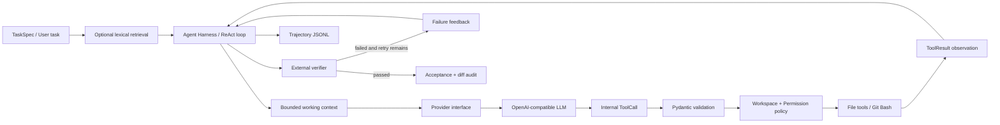

# CodePilot — Evaluation-first Coding Agent

CodePilot 是一个从零实现的 repository-level Coding Agent 求职项目。它不依赖现成 Agent 框架
完成主循环，而是自行实现 ReAct-style Agent Loop、Provider abstraction、结构化 Tool Calling、
受控工具执行、失败反馈、上下文管理、Repository Retrieval、Trajectory 和可复现 Evaluation。

> A compact, auditable coding-agent harness built with Python, Pydantic, Git and an
> OpenAI-compatible DeepSeek provider.

这个项目不试图复刻 Codex 或 Claude Code 的完整产品体验。它聚焦一个更容易验证的问题：

> 当 LLM 被允许修改代码时，Harness 如何约束它的动作、验证补丁，并用实验判断某项设计是否真的
> 改变成功率或执行成本？

## 项目亮点

| 能力 | CodePilot 的实现 |
| --- | --- |
| Agent Harness | 自行维护 Messages、RunState、ToolCall、ToolResult 和 termination |
| Model Provider | OpenAI-compatible 抽象；Phase 1–4 使用 DeepSeek 实测 |
| Controlled Tools | `list_files`、`read_file`、`search_text`、`edit_file`、受限 Git Bash |
| Safety Boundary | Pydantic 参数校验、Workspace 路径边界、允许修改文件和命令策略 |
| Reliability | 失败复现门禁、external verifier、failure feedback、bounded repair、max steps |
| Context | 完整审计历史与 Provider 工作视图分离；阈值式公开摘要 + 最近完整步骤 |
| Observability | JSONL trajectory 记录公开动作、工具结果、Token、延迟、上下文大小和状态变化 |
| Evaluation | 固定 Git baseline clone、acceptance、diff audit、轮转顺序与 context ablation |

Trajectory 只保存可公开的 action summary，例如“读取相关实现与测试”或“运行声明的验证命令”，
不要求、解析或持久化模型的隐藏 Chain-of-Thought。

## Agent 如何运行



模型不能直接操作本机。每次工具请求都要先变成 CodePilot 内部 `ToolCall`，通过输入模型、工作空间
边界和权限策略后，才会由 Tool Dispatcher 执行。模型声称“完成”也不等于任务成功，最终状态由
独立 verifier 决定。

更完整的数据流和模块职责见 [架构文档](docs/architecture.md)。

## Evaluation

### 实验设计

四种配置构成一个小型 2×2 对照：

| Configuration | Planning + reproduction gate | Lexical retrieval | Working context |
| --- | --- | --- | --- |
| `basic` | off | off | compact |
| `reliable` | on | off | compact |
| `retrieval` | off | on | compact |
| `full` | on | on | compact |

`reliable` 同时启用了公开 Planning 和修改前失败复现，因此 basic → reliable 的差异不能单独归因于
Planning。当前实现的四组默认都启用相同的 context compaction；另有 opt-in 的
`basic-uncompacted` / `full-uncompacted` 用于做上下文消融。一次 case 只有同时满足以下条件才算成功：

```text
Harness terminal_state == verified_success
+ external acceptance passed
+ 只修改 allowed files
+ tests / forbidden files 未被篡改
+ Git HEAD 未改变
```

### Hard Suite V2

Hard Suite V2 包含 6 个多文件契约任务。每题有 12–13 个实现文件、2–3 个参考修改点，并加入间接
调用、相似命名干扰或跨模块不变量。实验条件为 DeepSeek OpenAI-compatible Provider、temperature
0、`max_steps=12`、四配置各运行一次，共 24 cases。下表是引入 context compaction 前保存的
v0.2 基线结果；它用于展示主 Harness 四配置，不与后面的 context ablation 混算。

| Config | Strict success | Avg steps | Avg tokens | Avg latency | Avg reads | Denied total |
| --- | ---: | ---: | ---: | ---: | ---: | ---: |
| basic | 6/6 | 10.83 | 41,087.7 | 56.9s | 15.33 | 14 |
| reliable | 6/6 | 11.50 | 37,609.2 | 49.0s | 12.83 | 7 |
| retrieval | 6/6 | **9.17** | 37,793.2 | 51.1s | 13.83 | 14 |
| full | 6/6 | 10.17 | **36,701.8** | **47.1s** | **12.33** | **5** |

本轮可以支持的观察：

- 24/24 case 均通过 external acceptance、allowed-file audit 和 HEAD audit。
- Full 相对 Basic 平均 Token 少 10.7%、latency 少 17.3%、文件读取少 19.6%。
- Retrieval 的 changed-file Hit@3 为 100%，但 reference-patch file recall@K 为 61.1%；它能找到
  相关区域，却不能稳定覆盖所有跨文件修复点。
- 5 次运行在耗尽模型 step 时补丁已经正确。最终 verifier 在不增加 LLM 行动的情况下把它们正确
  收敛为 `verified_success`，避免将正确工作区误判为 `max_steps`。
- Full 并非每题都更快：`schema-alias-migration/full` 的 Token 和 latency 都高于 Basic，说明
  Planning + Retrieval 也可能因具体轨迹产生额外成本。

这些是 6 个合成任务、每配置单次运行的描述性结果，不是统计显著结论，也不等同 SWE-bench 或真实
工业仓库能力。完整数据、异常案例和限制见
[Hard Suite V2 结果](docs/hard_suite_v2_results.md)；旧协议如何暴露 benchmark 与 termination
问题见 [首轮探索记录](docs/hard_suite_v2_exploratory_results.md)。

### Working Context Compaction A/B

v0.3 将完整 `RunState.messages` 与实际发送给 Provider 的 working context 分离：完整历史继续用于状态
与审计；达到阈值后，较老的公开 action/observation steps 被确定性摘要替代，最近步骤仍保持完整。
摘要不读取或持久化隐藏 Chain-of-Thought。

默认策略为 `trigger=16000`、`max=32000`、`recent_steps=4`。第一轮 12-case 校准中，两组均 12/12
成功，但所有单轮上下文都低于16k，compact 组没有触发压缩。这验证了短任务不会再因 step 数量被
过早压缩，但不能用于声称压缩收益。

随后使用临时 `trigger=8000` 做强制触发实验：2 tasks × 2 context configurations × 3 repeats，共
12 cases。两组都启用相同的 Planning、失败复现与 lexical retrieval，Runner 使用 AB/BA 轮转顺序。

| Context configuration | Strict success | Avg steps | Avg input tokens | Avg total tokens | Avg latency | Avg reads | Compactions |
| --- | ---: | ---: | ---: | ---: | ---: | ---: | ---: |
| Full history | 6/6 | 9.50 | 33,042 | 35,637 | 43.6s | 10.17 | 0 |
| Compact | 6/6 | 8.50 | **25,746** | **27,790** | **37.6s** | **8.83** | 14 |

在该批小样本中，compact 保持 100% strict success，观察到平均输入 Token 少 22.1%、latency 少
13.9%。其中能由算法直接确认的机械收益是：累计消息字符约少 4.9%，平均单轮峰值上下文从 11,112
降到 9,811（约 11.7%）。其余差异包含模型轨迹缩短与随机波动，不能全部归因于压缩。人工检查还
发现 compact 组有 5 次重复读取、完整历史组有 2 次；总读取数仍更低，但这提示公开摘要可能导致
模型重新确认已修改文件。

因此项目保留16k作为默认安全阈值，8k只作为可证伪的压力实验。完整协议、逐 run 解释和限制见
[Context Compaction V2 实验](docs/context_ablation_v2_experiment.md)。

## Benchmark 覆盖

仓库包含 21 个自包含任务：15 个回归任务和 6 个 hard-v2 任务。hard-v2 覆盖：

| Task | 主要不变量 |
| --- | --- |
| Schema alias migration | 兼容旧字段输入，同时只输出 canonical schema |
| Role cache invalidation | 权限变更、事件 payload 与缓存失效保持一致 |
| Filtered cursor pagination | 过滤、排序、exclusive cursor 与 next cursor 语义 |
| Webhook dedup transaction | 失败不留记录，成功请求幂等且副作用只发生一次 |
| Plugin resolution shadowing | namespace、版本优先级与 fallback/error 语义 |
| Ledger transfer atomicity | 借贷原子性、请求幂等和 journal 不重复增长 |

TaskSpec 只向 Agent 提供公开 issue、工作空间、允许修改范围和验证命令；外部 acceptance 与参考补丁
保留在 evaluator 一侧，不会复制进 Agent workspace。

## 快速开始

### 1. 安装

要求：Python 3.11+、Git，以及 Windows 上的 Git Bash。

```powershell
git clone https://github.com/tuanziMilk/CodePilot.git
Set-Location CodePilot
python -m venv .venv
.\.venv\Scripts\Activate.ps1
python -m pip install -e ".[dev]"
Copy-Item .env.example .env
```

在 `.env` 中填写自己的模型配置：

```dotenv
LLM_PROVIDER=deepseek
LLM_MODEL=<your-model>
LLM_BASE_URL=https://api.deepseek.com
LLM_API_KEY=<your-api-key>
LLM_TEMPERATURE=0
AGENT_CONTEXT_TRIGGER_CHARS=16000
AGENT_CONTEXT_MAX_CHARS=32000
AGENT_CONTEXT_RECENT_STEPS=4
```

API Key 已被 `.gitignore` 排除，不应写入 TaskSpec、trajectory、Evaluation 报告或 Git。

### 2. 本地检查（不调用模型）

```powershell
python run.py doctor
python run.py prepare
python run.py validate
python run.py demo
python run.py test -q -p no:cacheprovider
python -m ruff check src tests
```

- `prepare`：生成 21 个带固定故障 commit 的本地 benchmark 仓库。
- `validate`：确认 buggy baseline 会失败、参考修复和外部 acceptance 会通过。
- `demo`：用 scripted Provider 演示完整 Agent Loop，不产生 API 费用，也不属于模型成绩。

### 3. 运行真实 Agent

先用一个小任务检查 API 与环境：

```powershell
python run.py eval `
  --task-file benchmarks\tasks\addition-smoke.json `
  --config basic `
  --config full
```

也可以对自己的可信仓库发起受限任务：

```powershell
python run.py run `
  --workspace E:\path\to\your-repo `
  --task "修复指定行为，并保持现有测试通过" `
  --verify-command "python -m pytest -q" `
  --allowed-edit-path src\target.py `
  --planning-mode required `
  --reproduction-policy on `
  --retrieval-mode lexical `
  --context-mode compact
```

运行测试或构建命令会执行目标仓库代码；只应把可信仓库交给当前 MVP。

### 4. 运行四配置 Evaluation

```powershell
python run.py eval --suite benchmarks\hard_suite_v2.json --dry-run
python run.py eval --suite benchmarks\hard_suite_v2.json
```

每个 case 都从 `initial_commit` 创建独立 clone，不会继承上一个配置已经修好的文件。命令结束后会
输出 `evaluation_dir`。

### 5. 查看报告和轨迹

```powershell
python run.py report "<evaluation_dir>"
python run.py view "<artifact_dir>\trajectory.jsonl"
```

单次 trajectory 可以沿着下面的链路阅读：

```text
User task → LLM response → validated ToolCall → tool execution
→ ToolResult observation → next LLM step → external verification
→ verified_success / failure feedback / max_steps
```

## 项目结构

```text
src/codepilot/
  agent/           ReAct loop、RunState、context compaction、termination 与 failure feedback
  llm/             Provider interface、wire mapping 与 DeepSeek adapter
  tools/           Pydantic 输入模型和受控工具
  environment/     Workspace 边界与 Git Bash process adapter
  permissions/     命令和修改范围策略
  retrieval/       Lexical repository retrieval
  verification/    独立测试验证
  trajectory/      JSONL 日志与 pretty viewer
  evaluation/      Clone、acceptance、diff audit 与聚合报告
  benchmarks/      Benchmark 生成和离线校验
benchmarks/         TaskSpec、suite、acceptance 与 reference fixes
tests/              unit / contract / integration tests
docs/               架构、实验结果、操作手册和学习记录
run.py              统一的本地入口
```

## 设计边界

- Workspace 与 PermissionPolicy 是应用层逻辑边界，不是 Docker 或操作系统级 sandbox。
- `edit_file` 使用“旧文本必须恰好出现一次”的精确替换策略，不支持 unified diff。
- Lexical retrieval 只在每个 run 开始时生成一次快照，没有 embedding、AST、Call Graph 或增量索引。
- Context compaction 是确定性的公开历史摘要，不是语义 Memory；字符预算只是 Token 的近似值。
- 8k context ablation 是 2 个合成任务上的强制触发实验；默认16k仍需更长任务继续验证。
- 当前 benchmark 为自建合成 Python 任务，规模不足以证明一般化性能提升。
- 暂不包含 Multi-Agent、MCP、长期 Memory、IDE Plugin、Web UI 或 RL。

这些限制是 MVP 的明确取舍：优先让 Agent Loop、权限、验证、轨迹和 Evaluation 保持小而可审查。

## 文档索引

- [快速操作手册](docs/quickstart_zh.md)
- [架构与核心设计](docs/architecture.md)
- [ReAct 与上下文管理学习手册](docs/react_context_learning_notes.md)
- [Context Compaction V2 实验](docs/context_ablation_v2_experiment.md)
- [Evaluation 协议](docs/evaluation_protocol.md)
- [完整实验结果](docs/evaluation_results.md)
- [Hard Suite V2 设计](docs/hard_suite_v2.md)
- [Hard Suite V2 结果](docs/hard_suite_v2_results.md)
- [真实 Trajectory 案例](docs/trajectory_example.md)
- [Failure Analysis](docs/failure_analysis.md)
- [Benchmark 目录](docs/benchmark_catalog.md)
- [项目介绍与 Demo](docs/resume_and_demo.md)
- [MVP 交付状态](docs/release_status.md)

Phase 1–4 学习文档保留了项目从最小 Agent Harness 到 Retrieval/Evaluation 的开发过程；其中个别
历史命令和早期指标不作为当前版本运行依据。
