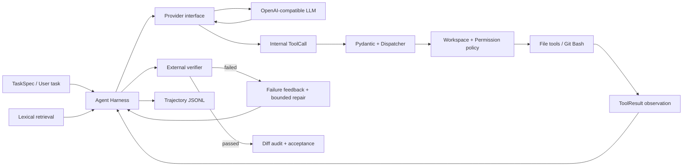

# CodePilot — 可评估、可审计的 Coding Agent

CodePilot 是一个从零实现的 repository-level Coding Agent 求职 MVP。它不依赖现成 Agent
框架完成主循环，而是自行实现 Provider abstraction、结构化 Tool Calling、状态循环、权限校验、
测试失败反馈、bounded repair、Repository Retrieval、Trajectory 和可复现 Evaluation。

> A compact, evaluation-first coding-agent harness built with Python, Pydantic, Git and an
> OpenAI-compatible DeepSeek provider.

项目重点不是堆叠 Multi-Agent、Memory 或 UI，而是回答三个可以被实验验证的问题：

1. 模型提出的动作如何经过校验后安全地作用于仓库？
2. 为什么模型声称完成不能作为成功条件，失败反馈怎样触发 repair？
3. Planning / reproduction control 与 lexical retrieval 是否改变成功率和执行成本？

## 已实现能力

- Provider-neutral Agent Harness：内部 `Message` / `ToolCall` / `ToolResult` 不依赖 DeepSeek。
- 五类受控工具：列目录、读文件、搜索、精确替换一次、受限 Git Bash。
- Pydantic 参数校验、Workspace 路径边界、允许修改文件与命令策略。
- 公开短计划、修改前失败复现门禁、max steps、external verification 与一次 bounded repair。
- run 开始时的 lexical repository retrieval，输出 Top-K 文件及可解释得分。
- JSONL trajectory：记录公开动作摘要、工具参数/结果、退出码、Token、延迟与状态变化；不保存私有
  Chain-of-Thought。
- Evaluation Runner：从固定 Git 故障 commit 创建独立 clone，运行可见测试、额外验收和 diff audit，
  生成 JSON / CSV / Markdown 报告。
- 15 个自包含 Python Coding Tasks，其中 5 个 challenge tasks 涉及原子性、图环、幂等、事件版本和
  重试分类。

## 架构



更完整的职责和数据流见 [docs/architecture.md](docs/architecture.md)。

## 实验结果

测试环境固定为：DeepSeek OpenAI-compatible Provider、temperature 0、`max_steps=12`、
`agent_max_retries=1`。成功必须同时满足 `verified_success`、额外验收通过和允许文件审计通过。

### 5-task challenge suite，四配置各运行一次

| Configuration | Success | Avg steps | Avg tokens | Avg latency |
| --- | ---: | ---: | ---: | ---: |
| basic | 5/5 | 7.8 | 19,593.8 | 40.1s |
| reliable | 5/5 | 7.8 | 21,336.6 | 45.9s |
| retrieval | 5/5 | **6.2** | 18,151.6 | 34.5s |
| full | 5/5 | 7.2 | **18,083.0** | **32.3s** |

### 两个代表任务，四配置各重复三次

| Configuration | Success | Avg steps | Avg tokens | Avg latency |
| --- | ---: | ---: | ---: | ---: |
| basic | 6/6 | 8.17 | 26,470.3 | 51.0s |
| reliable | 6/6 | 7.50 | 17,608.5 | 37.3s |
| retrieval | 6/6 | **6.67** | **17,115.0** | **33.8s** |
| full | 6/6 | 7.00 | 18,298.8 | 34.1s |

两轮都出现 100% 成功率，说明任务仍有天花板，不能据此宣称达到真实工业 Coding Agent 水平。
更有价值的观察是：external verifier 多次阻止模型在未修复时提前结束；一次 API 请求由 Provider
retry 恢复，另一次任务失败由 Agent repair 恢复，验证了两类 retry 的职责分离。Retrieval 在
challenge suite 中实现 Hit@3=100%，但小仓库的读取次数只略有变化，因此目前只报告相关性，不宣称
检索带来因果上的显著提升。

完整协议、逐任务结果和诚实边界见 [docs/evaluation_results.md](docs/evaluation_results.md) 与
[docs/failure_analysis.md](docs/failure_analysis.md)。评测对应源码 commit 为 `e6a2f51`；其后的改动
仅整理公开文档与 Git Bash 默认路径，不改变 Agent Harness 或实验逻辑。

## 快速开始

要求：Python 3.11+、Git、Windows Git Bash。

```powershell
git clone https://github.com/tuanziMilk/CodePilot
Set-Location codepilot
python -m venv .venv
.\.venv\Scripts\Activate.ps1
python -m pip install -e ".[dev]"
Copy-Item .env.example .env
```

在 `.env` 中填写自己的 `LLM_MODEL`、`LLM_BASE_URL`、`LLM_API_KEY`，并按本机安装位置调整
`GIT_BASH_PATH`。API Key 已被 `.gitignore` 排除，不能写进 TaskSpec、trajectory 或 Git。

以下命令不调用模型：

```powershell
python run.py doctor
python run.py prepare
python run.py validate
python run.py demo
python run.py test -q -p no:cacheprovider
python -m ruff check src tests
```

`prepare` 生成 15 个独立 Git 故障仓库；`validate` 验证每题的 buggy baseline 确实失败、参考修复及
额外验收确实通过；`demo` 使用 scripted Provider 演示真实工具循环，不能当作模型成绩。

## 运行真实 Agent 与 Evaluation

先用一题检查配置：

```powershell
python run.py eval `
  --task-file benchmarks\tasks\addition-smoke.json `
  --config basic `
  --config full
```

运行 challenge suite 的四配置比较：

```powershell
python run.py eval --suite benchmarks\challenge_suite.json
```

每个 case 都从 `initial_commit` 创建新 clone，不会复用已经修好的工作区。命令返回
`evaluation_dir` 后，可查看聚合报告和单次轨迹：

```powershell
python run.py report "<evaluation_dir>"
python run.py view "<artifact_dir>\trajectory.jsonl"
```

四个实验配置：

| Configuration | Public plan + reproduction gate | Lexical retrieval |
| --- | --- | --- |
| basic | off | off |
| reliable | on | off |
| retrieval | off | on |
| full | on | on |

这里的 reliable 同时启用 planning 和 reproduction，因而不能把 basic→reliable 的差异单独归因于
Planning。详细命令见 [docs/quickstart_zh.md](docs/quickstart_zh.md)。

## 项目结构

```text
src/codepilot/
  agent/           Agent loop、状态与 termination
  llm/             Provider interface 与 DeepSeek adapter
  tools/           Pydantic 输入模型和五类工具
  environment/     Workspace 与 Git Bash process adapter
  permissions/     命令和修改范围策略
  retrieval/       Lexical repository retrieval
  verification/    独立测试验证
  trajectory/      JSONL 日志与 pretty viewer
  evaluation/      Clone、验收、审计与报告
benchmarks/         TaskSpec、额外验收、参考修复与 suite
tests/              unit / contract / integration tests
docs/               架构、实验、失败分析和学习笔记
```

## 安全与局限

- Workspace 和 PermissionPolicy 是逻辑边界，不是 Docker 或操作系统级 sandbox。
- 运行 pytest 或项目构建会执行仓库代码，因此仅应运行可信 benchmark。
- `edit_file` 维持“旧文本恰好出现一次”的 MVP 策略，不支持 unified diff。
- Lexical retrieval 每个 run 只在开始时执行一次，不做 embedding、AST 或增量索引。
- Benchmark 是自建合成 Python 任务，不等同 SWE-bench，也不代表生产级仓库修复能力。
- 暂不包含 Multi-Agent、MCP、Memory、Docker、IDE Plugin 或 Web UI。

## 延伸文档

- [操作手册](docs/quickstart_zh.md)
- [架构与核心设计](docs/architecture.md)
- [Evaluation 协议](docs/evaluation_protocol.md)
- [正式实验结果](docs/evaluation_results.md)
- [真实 Trajectory 案例](docs/trajectory_example.md)
- [Benchmark 目录](docs/benchmark_catalog.md)
- [Failure Analysis](docs/failure_analysis.md)
- [Demo 与简历表述](docs/resume_and_demo.md)
- [MVP 交付状态](docs/release_status.md)

Phase 1–4 学习文档保留为开发过程记录；其中个别历史路径或早期指标不作为当前版本运行依据。
