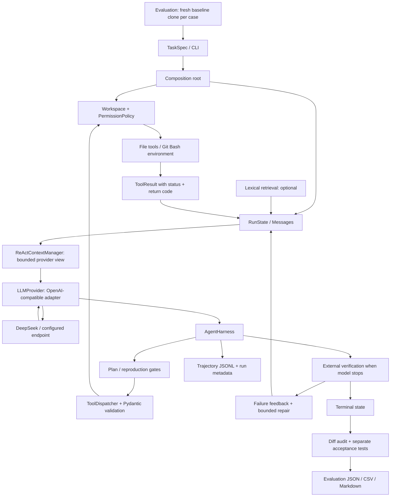

# 核心架构与设计解释

`AgentHarness` 拥有循环和状态，只依赖内部协议；Provider 将 HTTP JSON 转成 `Message`、
`ToolCall` 与 `Usage`。模型不会直接执行命令，工具调用必须通过 Dispatcher、参数模型、
路径边界及命令策略。`edit_file` 只替换恰好出现一次的 literal 文本。

`RunState.messages` 持有完整规范历史；`ReActContextManager` 固定保留任务上下文，把较老的公开
action/observation step 变成确定性摘要，并原样保留最近步骤，形成实际发给 Provider 的工作视图。
`ToolResult` 转成明确包含工具状态和退出码的 `role=tool` observation，模型据此决定后续动作。
一个 step 是一次 Provider completion，可以请求多个工具。该设计不要求或保存隐藏思维链。

`TaskSpec.allowed_files` 与 `forbidden_files` 是程序侧写约束，不当作源码定位答案发送给模型。
`visible_tests` 是任务元数据；模型可以通过文件工具发现它。声明的测试命令会作为一致的任务
运行上下文提供给所有实验组。这可能提供测试名称线索，实验报告须承认该设定；它让比较集中在
代码定位与修复，减少 Maven/pytest 参数猜测的干扰。

Planning 的 off 模式移除 `update_plan` schema，并拒绝模型伪造同名调用；required 模式要求
执行仓库工具前记录公开短计划。它不保证每次操作都遵守计划，更不保存私有推理。Reproduction
gate 要求成功执行的测试命令返回非零后才允许编辑，超时或工具内部错误不算已复现。

Provider retry 处理暂时性 HTTP/网络失败；repair retry 处理 Harness 最终验证失败后的修复。
它们分别记录，不能把连续工具试错计为 repair retry。`max_steps` 是模型行动的硬预算；耗尽时
Harness 会做最后一次外部验证，工作区正确则标记 `verified_at_step_limit`，否则返回 `max_steps`。

`LexicalRepositoryRetriever` 按任务 token 与文件路径/内容的重合排序，在每个 run 开始检索一次。
它不持续更新索引，也不做语义理解。每个 excerpt 有长度上限；数据标记为 reference，不承担
完整 prompt-injection 防护。模型仍可自行 list/read/search，检索不保证减少步骤。

`TrajectoryWriter` 保存公开动作、工具参数、结果、退出码、状态、usage 与耗时。HTTP adapter
忽略 `reasoning_content`，错误信息不序列化完整 HTTP 响应。Key 只留在本机环境配置中。

Evaluator 把基线 clone、模型运行、外部验收与 diff 审计分开。额外验收不进入 Agent prompt。
Harness 的 `verified_success` 是必要条件，Evaluator 还会检查测试保护和越权修改；这比单看
模型自述或一条测试返回码更容易发现“碰巧通过样例”的修复。
